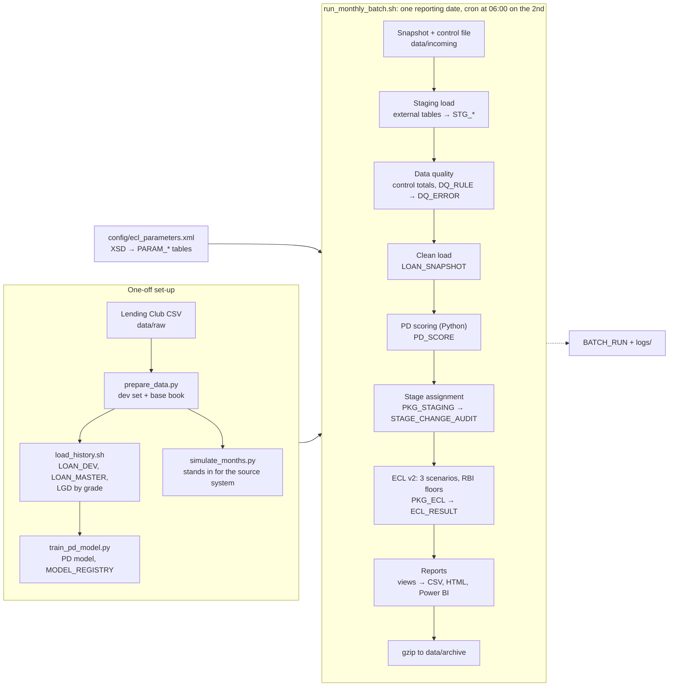

# IFRS 9 Expected Credit Loss Engine

A small version of the monthly provisioning run a bank does under IFRS 9. Each
month it loads a snapshot of the loan book into Oracle and rejects bad rows
with a data quality rules engine. It scores every loan's probability of default
with a Python model, puts each loan in Stage 1, 2 or 3, and calculates the
expected credit loss under three economic scenarios, with the Reserve Bank of
India's minimum provision floors. The data is Lending Club's public US loan
file: the March 2019 book is real, and the six months after it are simulated.
It runs on Oracle Database Free (SQL and PL/SQL), Python (pandas,
scikit-learn) and bash. One batch script runs the month, with a log, a lock
and restart from a failed step. It ends with CSV exports, an HTML report and a
guide to building a Power BI dashboard. This is a learning and portfolio
project, not production software.

## Architecture



## Results

Every number here is written by `python/readme_results.py` from the database
and the generated docs after a run. None is typed by hand.

<!-- results:start -->
The last full run covered 7 month-ends, Mar 2019 to Sep 2019. Mar 2019 is the real Lending Club book; Apr 2019 to Sep 2019 are simulated from it (see the limitations below).

**Sep 2019:** 83,720 loans with a balance of $773.6M and a final ECL of $51.7M, a coverage of 6.69%.

| Stage | Loans | Balance | Share of balance | Final ECL | Coverage |
| --- | ---: | ---: | ---: | ---: | ---: |
| Stage 1 | 79,491 | $730.8M | 94.47% | $29.6M | 4.06% |
| Stage 2 | 2,549 | $24.6M | 3.18% | $5.9M | 23.84% |
| Stage 3 | 1,680 | $18.2M | 2.35% | $16.2M | 89.20% |
| **Total** | **83,720** | **$773.6M** | **100.00%** | **$51.7M** | **6.69%** |

**Month by month.** Rows rejected by data quality never reach the calculation. Stage changes are the rows `TRG_STAGE_CHANGE_AUDIT` wrote; the first month has none because there is no earlier stage to change from.

| Month | Rows received | Rows rejected | Loans | Balance | Final ECL | Coverage | Stage changes |
| --- | ---: | ---: | ---: | ---: | ---: | ---: | ---: |
| Mar 2019 | 100,022 | 100 | 99,922 | $1,055.1M | $57.6M | 5.46% | 0 |
| Apr 2019 | 97,222 | 97 | 97,125 | $1,005.0M | $58.2M | 5.79% | 1,181 |
| May 2019 | 94,551 | 95 | 94,456 | $956.1M | $57.0M | 5.96% | 1,341 |
| Jun 2019 | 91,850 | 92 | 91,758 | $908.5M | $55.3M | 6.08% | 1,472 |
| Jul 2019 | 89,150 | 89 | 89,061 | $862.3M | $54.2M | 6.28% | 1,520 |
| Aug 2019 | 86,379 | 86 | 86,293 | $817.3M | $53.1M | 6.50% | 1,578 |
| Sep 2019 | 83,804 | 84 | 83,720 | $773.6M | $51.7M | 6.69% | 1,622 |

The simulator seeded 643 deliberate errors into the 7 files; data quality caught 643 of them, each with the rule meant to catch it.

**RBI floors, Sep 2019.** The floor set the final ECL of 10,539 loans and added $237,273 (0.46% of the final ECL).

| Stage | Loans floored | Added by floors |
| --- | ---: | ---: |
| Stage 1 | 9,840 | $98,604 |
| Stage 2 | 699 | $138,669 |
| Stage 3 | 0 | $0 |

**Scenarios, Sep 2019.** Total model ECL under each scenario, then weighted (60% / 30% / 10%) and floored.

| Base | Downside | Severe | Weighted | Final after floors |
| ---: | ---: | ---: | ---: | ---: |
| $46.5M | $55.3M | $69.8M | $51.5M | $51.7M |

**PD model.** Logistic regression trained on loans issued 2007 to 2014 and tested out of time on 2015 issues (104,383 loans): AUC 0.6861, Gini 0.3723, KS 0.2701, Brier 0.1201. Details in [docs/model_report.md](docs/model_report.md).

**ECL engine, v1 against v2.** On Mar 2019 (99,922 loans, best of three runs): set-based `run_v2` 7.45 s, row-by-row `run_v1` 8.09 s, the same ECL to the cent on every loan. A closed-form variant took 1.88 s. [docs/performance.md](docs/performance.md) explains why set-based SQL isn't automatically faster here.
<!-- results:end -->

## How to run it

### Prerequisites

- **Docker** (Docker Desktop on Windows or macOS). The database is Oracle Database Free, which limits itself to 2 CPU threads and 2 GB of memory.
- **Python 3.11** or later.
- **bash** with `curl`, `unzip`, `gzip` and `awk`: Linux, WSL, or Git Bash on Windows. The project was built and run with Git Bash ([decisions D-001](docs/decisions.md)).
- **Disk:** on the build machine the database volume grew to 6.2 GB over a full run. The raw CSV is 1.7 GB, the download 1.4 GB (deleted once unpacked), and seven months of reports about 0.1 GB.

### Steps

```bash
# 1. Settings, database and Python
cp .env.example .env                 # then set the two passwords in it
docker compose up -d                 # the first start sets up the database (a few minutes)
python -m venv .venv                 # Windows: py -3.11 -m venv .venv
source .venv/bin/activate            # Git Bash on Windows: source .venv/Scripts/activate
python -m pip install -r python/requirements.txt
scripts/smoke_test.sh                # SQL*Plus and python-oracledb both reach the database

# 2. Data: Lending Club accepted loans 2007-2018 from Kaggle (wordsforthewise/lending-club)
mkdir -p data/raw/download
curl -L -o data/raw/download/archive.zip \
  https://www.kaggle.com/api/v1/datasets/download/wordsforthewise/lending-club
unzip -o -j data/raw/download/archive.zip \
  'accepted_2007_to_2018q4.csv/accepted_2007_to_2018Q4.csv' -d data/raw
rm -r data/raw/download

# 3. One-off preparation
python python/prepare_data.py        # dev set and base book -> data/processed, docs/data_profile.md
scripts/setup_db.sh                  # the schema (--reset drops everything and rebuilds it)
scripts/load_history.sh              # LOAN_DEV, LOAN_MASTER, parameters, LGD by grade
python python/train_pd_model.py      # PD model, MODEL_REGISTRY, origination PDs, docs/model_report.md
python python/simulate_months.py     # seven monthly snapshots + control files -> data/incoming

# 4. The monthly batch, every month in data/incoming in date order
scripts/run_all_months.sh
```

If Kaggle asks you to sign in, download the dataset from its
[Kaggle page](https://www.kaggle.com/datasets/wordsforthewise/lending-club) with
a free account and put `accepted_2007_to_2018Q4.csv` in `data/raw/`.

The scripts find the venv's Python by themselves. Each step writes to the log
and to `BATCH_RUN` in Oracle, and the batch leaves `reports/YYYYMMDD/` for
every month: eight CSVs from the report views, `ecl_detail.csv` (one row per
loan) and `ecl_report.html`.

**One month at a time**

```bash
scripts/run_monthly_batch.sh 2019-09-30 --dry-run               # print the plan only
scripts/run_monthly_batch.sh 2019-09-30                         # run the month
scripts/run_monthly_batch.sh 2019-09-30 --from-step score_pd    # restart a failed run at a step
```

Exit codes are 0 for success, 1 for a failed step (or a held lock) and 2 for
bad arguments. [docs/runbook.md](docs/runbook.md) covers restarts and every
failure the batch can stop on. `scripts/crontab.example` schedules the batch
for the 2nd of each month. The demo dates are historical, so
`run_all_months.sh` is how the project actually runs.

**Tests**

```bash
python -m pytest                     # the full suite (needs the database and a completed run)
python -m pytest -m "not slow"       # skip the batch re-run tests, which run the real batch three times
```

**Generated docs**, refreshed after a run:

```bash
python python/benchmark_ecl.py --reporting-date 2019-03-31   # docs/performance.md
python python/golden_example.py                               # the worked example in docs/methodology.md
scripts/generate_data_dictionary.sh                           # docs/data_dictionary.md
python python/readme_results.py                               # the Results section above
```

## Methodology in brief

The full method, with formulas and a worked example, is in
[docs/methodology.md](docs/methodology.md). Every threshold, weight and floor
below is a value in `config/ecl_parameters.xml`. The file is validated against
an XSD and loaded into Oracle with `XMLTABLE`, so nothing is hardcoded in the
PL/SQL.

- **PD.** A logistic regression on application data, trained on loans issued up to 2014 and tested out of time on 2015 issues. Term PD is converted to a 12-month PD with a constant hazard. Each loan gets two PDs: one at origination, and one with today's FICO score in place of the original.
- **Staging,** first rule that applies:
  - Stage 3: over 90 days past due, or in default.
  - Stage 2: over 30 days past due, forbearance, or PD deterioration (current PD at least twice the origination PD *and* at least 0.5 points higher).
  - Back to Stage 1 only after three straight good months.
  - Every stage change is written to `STAGE_CHANGE_AUDIT` by a trigger.
- **LGD.** Calibrated by grade from charged-off loans' recoveries, weighted by exposure at default.
- **EAD.** The balance rolled forward on the loan's level-payment schedule.
- **ECL.** The discounted sum of monthly marginal losses: 12 months for Stage 1, the remaining life for Stage 2. Stage 3 is LGD × balance.
- **Scenarios.** Base, downside and severe: PD multipliers of 1.0, 1.3 and 1.8, weighted 60/30/10.
- **RBI floors.** The final ECL is never below the floor:
  - Stage 1: 1% of balance. Stage 2: 5%.
  - Restructured (forbearance) loans: 5% in Stage 1, 10% in Stage 2.
  - Stage 3: 40% for the first 12 months, 100% after that.
- **Two engines.** `run_v2` is the production engine: one set-based `INSERT ... SELECT` over a month-index row source. `run_v1` is a deliberately row-by-row loop. Both must agree to the cent on every loan ([docs/performance.md](docs/performance.md)).

## Project structure

```
ifrs9-ecl-engine/
├── README.md
├── docker-compose.yml          # one service, ecl-oracle (Oracle Database Free)
├── .env.example                # copy to .env (git-ignored)
├── config/                     # ecl_parameters.xml + .xsd, settings.json
├── data/                       # raw, processed, incoming, archive (all git-ignored)
├── db/
│   ├── install.sql, reset.sql  # build and drop the schema
│   ├── 00_directories.sql ... 05_views.sql
│   ├── packages/               # PKG_BATCH_LOG, PARAMS, LOAD, DQ, LGD, STAGING, ECL (.pks/.pkb)
│   ├── triggers/               # stage change audit, parameter audit
│   ├── seed/                   # data quality rules, month index
│   ├── reports/                # SQL*Plus CSV exports
│   └── benchmark/              # the three extra ECL variants that are only benchmarked
├── python/
│   ├── ecl/                    # shared code: DB, config, PD maths, ECL maths, SVG charts
│   └── prepare_data.py, train_pd_model.py, simulate_months.py, score_pd.py,
│       make_report.py, benchmark_ecl.py, golden_example.py, readme_results.py
├── scripts/
│   ├── lib/common.sh           # strict mode, logging, run_sql, error trap
│   ├── setup_db.sh, load_history.sh, load_params.sh
│   ├── run_monthly_batch.sh, run_all_months.sh, crontab.example
│   └── export_reports.sh, generate_data_dictionary.sh, verify_incoming.sh, smoke_test.sh
├── models/                     # model metadata (the .joblib binary is git-ignored)
├── reports/                    # per reporting date (git-ignored)
├── logs/                       # batch logs (git-ignored)
├── tests/                      # pytest against the running database
└── docs/                       # see below
```

| Document | Contents |
|---|---|
| [SPEC.md](docs/SPEC.md) | The build specification |
| [methodology.md](docs/methodology.md) | Staging, PD, LGD, EAD, ECL, scenarios, floors, the golden worked example |
| [model_report.md](docs/model_report.md) | PD model data, features, out-of-time results, calibration by decile (generated) |
| [performance.md](docs/performance.md) | Row-by-row against set-based ECL, measured (generated) |
| [data_dictionary.md](docs/data_dictionary.md) | Every table and column, from the Oracle comments (generated) |
| [data_profile.md](docs/data_profile.md) | Profile of the raw data and the choices made from it (generated) |
| [runbook.md](docs/runbook.md) | Running, restarting and troubleshooting the batch |
| [powerbi_guide.md](docs/powerbi_guide.md) | Building the dashboard from the CSV exports |
| [decisions.md](docs/decisions.md) | Every change from the spec, and why |
| [sample_report/](docs/sample_report/) | One month's report: HTML, CSVs and a screenshot |

## Simplifications and limitations

- **The monthly history is simulated.** The public data is a single snapshot, so only March 2019 is real. April to September are simulated from it with a roll-rate matrix (`config/settings.json`), with deliberate errors seeded into every file.
- **The RBI rules are applied to a US dataset as an exercise.** The staging backstops and provision floors come from the Reserve Bank of India's ECL directions. Lending Club is a US lender. Stage 3 is assessed per loan, not per borrower, because the public data has no usable borrower id.
- **The PD model ranks better than it calibrates.** On the 2015 test vintage the mean predicted PD is 2.18 points below the observed default rate ([model report](docs/model_report.md)). A production model would be recalibrated or carry a margin of conservatism. Today's FICO is plugged into a model trained on origination FICO.
- **The method is simplified.** The hazard is constant over a loan's life. The contract rate stands in for the effective interest rate, and there are no prepayments. LGD is a historical average by grade with undiscounted recoveries. The scenarios are fixed PD multipliers, not a macroeconomic model.
- **The environment.** Built and run on one Windows laptop with Git Bash rather than WSL, against Oracle Database Free (2 CPU threads), so the timings are laptop timings. Cron is documented but not scheduled. The Power BI guide hasn't been tried in Power BI ([decisions](docs/decisions.md)).

## What I'd build next

- A downside scenario linked to an unemployment path, instead of a fixed PD multiplier.
- A `BULK COLLECT` / `FORALL` version of the ECL loop, timed against `run_v1` and `run_v2`.
- RBI Annex 4 disclosures: stage-wise amounts and movements by product, geography and grade. The views already cut ECL by grade and state.
- utPLSQL unit tests for the packages, and a GitHub Actions workflow that starts the Oracle container and runs the suite on every push.
- PD term structures by vintage in place of the constant hazard.
