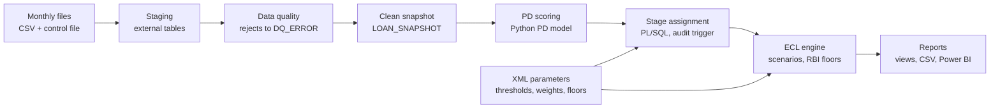

# IFRS 9 Expected Credit Loss Engine: Build Spec

> Transcribed from the 32-page PDF of the build spec. The Uniqus and ICRA source
> links could not be recovered from the page images, so they appear as plain text
> under [Sources](#sources). Changes made while building are recorded in
> [decisions.md](decisions.md), not here.

## How to use this spec

Give this whole spec to Claude Code and have it build the project in 14 phases, stopping after each one so you can check and understand the work.

**Do these yourself first**

1. Create an empty folder called `ifrs9-ecl-engine`. Export this doc as Markdown and save it there as `SPEC.md`.
2. Download the Lending Club loan data from Kaggle (a free account is needed) and put the accepted-loans CSV in `data/raw/`. Claude Code can't log in to Kaggle for you. The Data section says which file.
3. Install Docker Desktop. On Windows, also install WSL2 with Ubuntu and run everything from the Ubuntu terminal, because the batch scripts are bash and the scheduler is cron.
4. Install Python 3.11 or newer inside that Linux environment.

**Kickoff prompt to paste into Claude Code**

```
Read SPEC.md in this folder. It describes a portfolio project: an IFRS 9
expected credit loss engine built on Oracle Database with PL/SQL, Python and
bash.

Build it phase by phase, in the order given under "Build phases". For each
phase:
1. Tell me in a few lines what you are about to build and why.
2. Build it, then run the checks listed for that phase.
3. Commit with a clear message.
4. Summarise what you built, what the checks showed, and anything you changed
from the spec and why.
Then wait for me to say "next" before starting the following phase.

Rules:
- I will explain every part of this in a job interview. Keep the code
readable and comment the why, not the what.
- Never invent numbers for the README or docs. Only report numbers the code
actually produced.
- Ask before installing anything system-wide or touching files outside this
folder.
- If part of the spec does not work in my environment, propose the smallest
change that keeps the same idea and record it in docs/decisions.md.
```

Keep `SPEC.md` in the repo under `docs/`. It doubles as the project's specification document, which is one of the duties listed in the job description.

## Project overview

The project is a small version of what a bank's IFRS 9 system does every month: take the loan book, decide each loan's stage, and calculate how much to set aside for expected losses.

**What it does**

- Loads monthly loan snapshots into Oracle staging tables, runs data quality checks, and rejects bad rows with a reason.
- Scores each loan's probability of default (PD) with a Python logistic regression model.
- Puts each loan in Stage 1, 2 or 3 based on days past due, forbearance and PD deterioration.
- Calculates 12-month or lifetime ECL from PD, LGD and EAD, discounted at the loan's interest rate and weighted across three economic scenarios.
- Applies RBI minimum provision floors.
- Logs every stage change through a trigger, runs as a monthly bash batch scheduled with cron, and produces management reports.

**One monthly batch turns a snapshot file into provisions and reports**



*A bash batch on cron runs every step in order and logs each one to `BATCH_RUN`.* (monthly batch · 8 steps, XML config, cron)

Rows that fail a reject rule stop at data quality, so every step after it works on clean data only.

**How it maps to the job description**

| The JD asks for | Where the project shows it |
|---|---|
| SQL procedures, functions, triggers | PL/SQL packages for data quality, staging and ECL; audit triggers |
| Optimizing SQL | Row-by-row and set-based ECL versions, with measured timings |
| Unix commands and shell scripting | Monthly batch script with logging, locking, log rotation and cron |
| Management and regulatory reports | Provisions by stage, stage migration, floor impact, scenario sensitivity |
| XML and Java basics | XML parameter file parsed with XMLTABLE; optional Java XSD validator |
| Troubleshooting database issues | Data quality error table, batch run log, runbook |
| Documentation and specifications | This spec, methodology note, data dictionary, runbook |
| IFRS 9 (an OFSAA subject area) | The whole engine |

**Scope and simplifications**

- Unsecured retail loans only (Lending Club personal loans), in US dollars. The RBI rules are applied to this US data as an exercise.
- Monthly history is simulated from one real snapshot, because the public data has no month-by-month delinquency history. Everything simulated is labelled as such.
- Term PD is converted to 12-month and lifetime PD with a constant-hazard assumption. Scenarios are PD multipliers, not a macroeconomic model.
- LGD is a historical average by loan grade, with no collateral and no cure modelling.
- RBI floor rates live in config and must be checked against the published directions before you quote them.
- This is a learning and portfolio project, not production software. The README says so.

## Tech stack and environment

Everything runs locally for free: Oracle Database Free in Docker, Python for data and modelling, and bash plus cron for the monthly batch.

| Layer | Choice | Notes |
|---|---|---|
| Database | Oracle Database Free, regular [`gvenzl/oracle-free`](https://hub.docker.com/r/gvenzl/oracle-free) image | Not the `-slim` flavour, which drops advanced features. The project needs XML DB and external tables. Service name `FREEPDB1`. |
| SQL client | SQL*Plus inside the container, called with `docker exec` | Every SQL script starts with `WHENEVER SQLERROR EXIT SQL.SQLCODE` so the batch stops on errors. |
| Python | 3.11+, `python-oracledb` in thin mode, pandas, numpy, scikit-learn, lxml, matplotlib, pytest | Thin mode needs no Oracle Instant Client. |
| Batch | bash, cron, and standard Unix tools: grep, awk, find, gzip, flock | On Windows, run from WSL2 Ubuntu. |
| Reporting | SQL views, CSV exports, a static HTML report, and a Power BI dashboard built by hand | Claude Code can't produce `.pbix` files, so the Power BI part is a written guide. |
| Optional | Java 17 and a small XSD validator | Stretch goal only. |
| Version control | git and GitHub | Raw data, model binaries and secrets are never committed. |

**Environment rules for Claude Code**

- Keep connection settings in `.env` (git-ignored) and commit only `.env.example`.
- Use Docker Compose with one service, `ecl-oracle`, a named volume for the database files, and bind mounts for `./db`, `./config`, `./data/incoming` and `./data/processed`. SQL*Plus, external tables and `BFILE` reads all need to see those folders from inside the container.
- If the container's `oracle` user can't read the mounted folders, fix permissions first. As a last resort, load CSVs with `python-oracledb` batch inserts, but still parse the XML in PL/SQL by passing it in as a CLOB.
- Oracle Database Free caps CPU, memory and data size. Keep sample sizes in config (start with 250,000 loans for modelling and 100,000 for the live book) and scale up only if runs stay fast.
- Every script must be re-runnable. Running a step twice for the same reporting date gives the same result, not duplicates.

## Data

One real dataset feeds everything: Lending Club's accepted loans from 2007 to 2018, split into closed loans for modelling and open loans for the monthly ECL runs.

**Source**

- [All Lending Club loan data on Kaggle](https://www.kaggle.com/datasets/wordsforthewise/lending-club). Use `accepted_2007_to_2018Q4.csv` (it may arrive gzipped). It has over 2 million loans and 151 columns.
- Put it in `data/raw/`. It is never committed to git.

**Columns to keep**

| Purpose | Columns |
|---|---|
| Identity and status | `id`, `loan_status`, `issue_d`, `term` |
| Model features (known at application) | `loan_amnt`, `funded_amnt`, `int_rate`, `installment`, `grade`, `sub_grade`, `emp_length`, `home_ownership`, `annual_inc`, `verification_status`, `purpose`, `addr_state`, `dti`, `delinq_2yrs`, `earliest_cr_line`, `fico_range_low`, `fico_range_high`, `inq_last_6mths`, `open_acc`, `pub_rec`, `revol_bal`, `revol_util`, `total_acc`, `mort_acc`, `pub_rec_bankruptcies`, `application_type` |
| LGD calibration (closed loans only) | `total_rec_prncp`, `recoveries`, `collection_recovery_fee` |
| Live book snapshot (open loans only) | `out_prncp`, `last_fico_range_low`, `last_fico_range_high`, `hardship_flag`, `last_pymnt_d` |

**Leakage rule.** These columns are only known after the loan has run, so they must never be model features: `out_prncp`, `out_prncp_inv`, `total_pymnt`, `total_pymnt_inv`, `total_rec_prncp`, `total_rec_int`, `total_rec_late_fee`, `recoveries`, `collection_recovery_fee`, `last_pymnt_d`, `last_pymnt_amnt`, `next_pymnt_d`, `last_credit_pull_d`, `last_fico_range_*`, all `hardship_*` and `settlement_*` columns, `debt_settlement_flag` and `pymnt_plan`. Using `out_prncp` as today's exposure in the live book is fine, because at a reporting date the balance is known. The rule is about model features only. Also drop free text and junk: `url`, `desc`, `title`, `emp_title`, `zip_code`, `member_id`, `policy_code`.

**Split 1: development set (closed loans) to `data/processed/loans_dev.csv`**

- Statuses `Fully Paid` and `Charged Off`, plus the two `Does not meet the credit policy. Status:...` variants mapped to the same outcomes.
- Target `default_flag` = 1 for charged off, 0 for fully paid.
- Matured vintages only: 36-month loans issued by December 2015 and 60-month loans issued by December 2013. Every loan then had its full term to play out before the data cut-off, which avoids bias toward early defaults or early payoffs.
- Random sample to the configured size with a fixed seed.

**Split 2: live book (open loans) to `data/processed/portfolio_base.csv`**

- Statuses `Current`, `In Grace Period`, `Late (16-30 days)`, `Late (31-120 days)` and `Default`.
- Base reporting date = the month-end of the latest `last_pymnt_d` in the file. Claude Code checks it and records it in `docs/decisions.md`.
- Starting days past due (DPD) from status, drawn with a fixed seed: Current 0, In Grace Period 1 to 15, Late (16-30) 16 to 30, Late (31-120) 31 to 120, Default 121 to 150.
- Exposure = `out_prncp`. Current FICO = average of `last_fico_range_low` and `last_fico_range_high`. Forbearance flag = `hardship_flag`. Remaining term = term minus months since `issue_d`.
- Drop loans with zero balance or no remaining term. Sample to the configured size, keeping the status mix.

**Simulated monthly history**

The public file is one snapshot, so the next six month-ends are simulated from it. Every row carries `data_source` = `LC_ACTUAL` or `SIMULATED`, and the README says so plainly.

- Each month, every loan moves between DPD buckets using a roll-rate matrix kept in `config/simulation.json`. The default below is illustrative, not calibrated; each row sums to 100%.
- Loans that pay on time amortise by the principal part of their instalment. Delinquent loans don't. Paid-off and written-off loans leave the book.
- Current FICO drifts with small random noise, drops when a loan rolls to a worse bucket, partly recovers on cure, and stays within 300 to 850.
- The forbearance flag can switch on for delinquent loans with a small probability.
- Output per month-end: `data/incoming/loan_snapshot_YYYYMMDD.csv` plus `control_YYYYMMDD.csv` holding the row count and total outstanding principal of the file as written.
- A configurable share of rows (default 0.1%) gets deliberate errors so the data quality checks have work to do: negative balance, missing loan id, unknown loan id, a duplicate row, non-numeric DPD.

| From \ To (% per month) | Current | 1-30 | 31-60 | 61-90 | 90+ | Paid off | Written off |
|---|---|---|---|---|---|---|---|
| Current | 96.5 | 2.0 | 0 | 0 | 0 | 1.5 | 0 |
| 1-30 | 45 | 15 | 38 | 0 | 0 | 2 | 0 |
| 31-60 | 15 | 10 | 10 | 65 | 0 | 0 | 0 |
| 61-90 | 8 | 0 | 5 | 12 | 75 | 0 | 0 |
| 90+ | 3 | 0 | 0 | 0 | 72 | 0 | 25 |

## Methodology

Each month, every open loan gets a stage, a PD, an LGD and an exposure. ECL is the scenario-weighted, discounted expected loss over 12 months for Stage 1 and over the remaining life for Stages 2 and 3, and it never goes below the RBI floor.

**1. PD model (Python)**

- Logistic regression on the development set, target `default_flag`, features from the application-time columns only.
- Derived features: FICO = average of the two range columns, credit history in months = `issue_d` minus `earliest_cr_line`, log of `annual_inc` and `revol_bal`.
- scikit-learn `Pipeline`: median imputation and scaling for numbers, one-hot encoding for categories (`grade`, `term`, `home_ownership`, `verification_status`, `purpose`, `emp_length`, `application_type`).
- No class weighting and no resampling. PDs must be real probabilities, and reweighting inflates them.
- Out-of-time validation: train on loans issued up to 2014, test on 2015 issues. Report AUC, Gini (2 × AUC − 1), KS, Brier score, and a calibration table by score decile (predicted vs observed default rate).
- Save the model with joblib plus a metadata JSON: version, features, metrics, training date range.

The model predicts default over the loan's full term T (36 or 60 months). Convert it to a 12-month PD with a constant-hazard assumption:

```math
PD_{12m} = 1 - (1 - PD_{term})^{12/T}
```

Two PDs are stored per loan:

- `pd_12m_orig`: scored with the application data, as at origination.
- `pd_12m_current`: the same model and features, but with FICO replaced by the current FICO from the snapshot, so a falling credit score raises the PD.
- Both get a minimum of 0.05% (config `pdFloor`) as a modelling safeguard.

**2. Staging rules (PL/SQL function), checked in this order**

1. **Stage 3** if DPD > 90 or status is `Default`. This mirrors the 90-day NPA rule that the RBI kept in its final ECL directions (Uniqus).
2. **Stage 2** if any of these hold:
   - DPD > 30, the rebuttable 30-day backstop for term loans in the final directions (Uniqus).
   - The forbearance flag is `Y`.
   - PD deterioration: `pd_12m_current` ≥ 2 × `pd_12m_orig` and the increase is at least 0.5 percentage points. Both thresholds live in config.
   - Cure rule: the loan was in Stage 2 or 3 last month and hasn't yet had 3 straight months meeting Stage 1 conditions. The RBI dropped its mandatory six-month cooling period in the final directions, so this is a bank policy setting.
3. **Stage 1** otherwise.

Every stage decision stores a reason code: `DPD_90`, `DEFAULT_STATUS`, `DPD_30`, `FORBEARANCE`, `PD_DETERIORATION`, `CURE_PROBATION` or `PERFORMING`.

**3. PD used for measurement**

- Stages 1 and 2: `pd_12m_current` × a DPD multiplier from config (0 DPD: 1.0, 1 to 30: 2.0, 31 to 60: 3.5, 61 to 90: 6.0), capped at 0.99.
- Stage 3: PD = 1.
- The DPD multiplier affects measurement only, not the staging test. Delinquency already drives staging through the 30-day backstop.

**4. LGD (calibrated in SQL)**

From charged-off loans in the development set:

```math
LGD = 1 - \frac{recoveries - collection\_recovery\_fee}{funded\_amnt - total\_rec\_prncp}
```

- Average by loan grade A to G, weighted by exposure at default, bounded between 0 and 1, stored in `PARAM_LGD` with the sample size.
- A grade with fewer than 500 defaults (config) falls back to the portfolio average.
- Recoveries aren't discounted. A real workout LGD would discount them at the loan's effective interest rate.

**5. Exposure (EAD)**

With current balance B, monthly rate r = `int_rate` / 12 and n remaining months, rebuild a level payment and roll the balance forward:

```math
P = \frac{B \, r}{1 - (1 + r)^{-n}}, \qquad B_t = B_{t-1}(1 + r) - P, \qquad EAD_t = B_{t-1}
```

Stage 3 uses today's balance with no schedule. There's no accrued interest and no undrawn limit, because these are term loans.

**6. ECL**

Turn the 12-month PD into a monthly hazard, then sum discounted marginal losses over the horizon H. H = min(12, n) for Stage 1 and H = n for Stage 2. The contract rate stands in for the effective interest rate.

```math
h = 1 - (1 - PD_{12m})^{1/12}
```

```math
ECL = \sum_{t=1}^{H} (1 - h)^{t-1} \, h \cdot LGD \cdot EAD_t \cdot (1 + r)^{-t}
```

Stage 3: ECL = LGD × current balance.

The RBI requires probability-weighted multiple scenarios, and base, downside and severe downside is the common setup (Uniqus). Run the ECL once per scenario with PD × the scenario multiplier (capped at 0.99), then weight the results. The default weights and multipliers below are illustrative and live in the XML config.

| Scenario | Weight | PD multiplier |
|---|---|---|
| Base | 60% | 1.00 |
| Downside | 30% | 1.30 |
| Severe downside | 10% | 1.80 |

**7. RBI floors**

Final ECL = the larger of the weighted model ECL and floor rate × current balance. Store model ECL, floor amount, final ECL and a `floor_applied` flag separately, because the floor impact report needs all four. Floors for unsecured retail loans under the final directions, per ICRA and Uniqus:

| Case | Floor (% of balance) |
|---|---|
| Stage 1 | 1.00% |
| Stage 2 | 5.00% |
| Forbearance loan in Stage 1 (restructured) | 5.00% |
| Forbearance loan in Stage 2 (restructured) | 10.00% |
| Stage 3, up to 1 year in Stage 3 | 40% |
| Stage 3, over 1 year in Stage 3 | 100% |

The Stage 3 rows are the general schedule for unsecured exposures. Check Annex N of the directions before quoting them as the unsecured retail schedule.

**8. Known simplifications to state in the README**

- Constant hazard over the loan's life, and the contract rate used as the effective interest rate.
- Staging is tested on the base scenario only.
- Stage 3 is assessed per loan. The RBI applies it per borrower, but the public data has no usable borrower id.
- Current FICO is plugged into a model trained on origination FICO.

## Repository layout

One folder per layer: config, data, database code, Python, shell scripts, tests and docs.

```
ifrs9-ecl-engine/
├── README.md
├── docker-compose.yml
├── .env.example
├── .gitignore
├── config/
│   ├── ecl_parameters.xml        # staging thresholds, multipliers, scenarios, floors
│   ├── ecl_parameters.xsd        # schema the XML must pass
│   └── settings.json             # sample sizes, seed, months to simulate, roll-rate matrix
├── data/
│   ├── raw/                      # Lending Club CSV (git-ignored)
│   ├── processed/                # dev set and base portfolio (git-ignored)
│   ├── incoming/                 # monthly snapshot and control files (git-ignored)
│   └── archive/                  # files the batch has processed, gzipped (git-ignored)
├── db/
│   ├── install.sql               # runs every script below in order
│   ├── 01_tables.sql
│   ├── 02_constraints_indexes.sql
│   ├── 03_comments.sql
│   ├── 04_directories_external_tables.sql
│   ├── 05_views.sql
│   ├── packages/
│   │   ├── pkg_batch_log.pks / .pkb   # run logging helpers
│   │   ├── pkg_params.pks / .pkb      # XML parameter load
│   │   ├── pkg_load.pks / .pkb        # history and monthly staging loads
│   │   ├── pkg_dq.pks / .pkb          # data quality rules engine
│   │   ├── pkg_lgd.pks / .pkb         # LGD calibration
│   │   ├── pkg_staging.pks / .pkb     # stage assignment
│   │   └── pkg_ecl.pks / .pkb         # ECL v1 and v2, scenarios, floors
│   ├── triggers/
│   │   ├── trg_stage_change_audit.sql
│   │   └── trg_param_audit.sql
│   └── seed/
│       └── dq_rules.sql
├── python/
│   ├── requirements.txt
│   ├── ecl/                      # shared code: DB connection, config, logging
│   ├── prepare_data.py
│   ├── train_pd_model.py
│   ├── simulate_months.py
│   ├── score_pd.py
│   └── make_report.py
├── scripts/
│   ├── lib/common.sh             # logging, run_sql, error trap
│   ├── setup_db.sh
│   ├── load_history.sh
│   ├── run_monthly_batch.sh
│   ├── run_all_months.sh
│   ├── generate_data_dictionary.sh
│   └── crontab.example
├── models/                       # model metadata committed, binaries git-ignored
├── reports/                      # generated per reporting date (git-ignored)
├── logs/                         # batch logs (git-ignored)
├── tests/
└── docs/
    ├── SPEC.md
    ├── methodology.md
    ├── data_dictionary.md        # generated from Oracle column comments
    ├── model_report.md
    ├── runbook.md
    ├── powerbi_guide.md
    ├── decisions.md
    ├── performance.md
    ├── data_profile.md
    └── sample_report/            # one month's report, committed for GitHub viewers
```

- One PL/SQL package per job, with spec (`.pks`) and body (`.pkb`) in separate files.
- Python scripts are thin command-line entry points (`--reporting-date`, `--config`). Shared logic lives in `python/ecl/`.
- Never commit `.env`, raw or generated data, logs or model binaries.

## Database design

The schema follows the path the data takes each month: external file, staging, data quality, clean snapshot, scores, stages, ECL results, reports.

**Tables**

| Table | Purpose | Key |
|---|---|---|
| `LOAN_MASTER` | Application data for each live-book loan, plus `pd_12m_orig` | `loan_id` |
| `LOAN_DEV` | Closed loans for modelling and LGD calibration | `loan_id` |
| `EXT_LOAN_SNAPSHOT`, `EXT_CONTROL` | External tables over the incoming CSVs, all columns text | none |
| `STG_LOAN_SNAPSHOT` | Raw rows as received, plus `run_id` and `row_num` | `reporting_date`, `row_num` |
| `STG_CONTROL` | Expected row count and total balance from the control file | `reporting_date` |
| `DQ_RULE` | Data quality rules as metadata: predicate, severity, message | `rule_id` |
| `DQ_ERROR` | One row per failed check | identity |
| `LOAN_SNAPSHOT` | Clean, typed monthly data: DPD, balance, current FICO, forbearance flag, remaining months, `data_source` | `reporting_date`, `loan_id` |
| `PD_SCORE` | `pd_12m_orig`, `pd_12m_current`, `model_version` | `reporting_date`, `loan_id` |
| `LOAN_STAGE_CURRENT` | Latest stage per loan, `stage_since`, `stage3_since`, cure month counter | `loan_id` |
| `STAGE_CHANGE_AUDIT` | Every stage change, written by trigger | identity |
| `ECL_RESULT` | Stage, reason, balance, LGD, PD, ECL per scenario, weighted ECL, floor, final ECL, `floor_applied` | `reporting_date`, `loan_id` |
| `ECL_RESULT_V1` | Same shape, written only by the row-by-row benchmark | `reporting_date`, `loan_id` |
| `PARAM_SETTING`, `PARAM_SCENARIO`, `PARAM_DPD_MULTIPLIER`, `PARAM_FLOOR` | Values loaded from the XML config | natural keys |
| `PARAM_LGD` | LGD by grade with sample size and calibration date | `grade` |
| `PARAM_AUDIT` | Every parameter change: old value, new value, who, when | identity |
| `MODEL_REGISTRY` | Each trained PD model: version, periods, AUC, Gini, KS, Brier, features | `model_version` |
| `BATCH_RUN` | One row per batch step: status, timings, row counts, message | identity |

**Packages**

| Package | Main routines | Notes |
|---|---|---|
| `PKG_BATCH_LOG` | `start_step`, `end_step` | Uses `PRAGMA AUTONOMOUS_TRANSACTION` so log rows survive a rollback |
| `PKG_PARAMS` | `load_from_xml`, `get_number` | Reads the XML through a `BFILE`, parses with `XMLTABLE`, checks scenario weights sum to 1, merges into the param tables |
| `PKG_LOAD` | `load_history`, `load_snapshot`, `load_clean`, `purge_date` | Repoints the external table with `ALTER TABLE ... LOCATION`, bulk-inserts with `APPEND`, clears a date before a re-run |
| `PKG_DQ` | `run_checks`, `reconcile_control` | Runs each active rule with dynamic SQL and bind variables; stops the batch if rejects pass the configured share or control totals don't match |
| `PKG_LGD` | `calibrate` | Set-based calibration from `LOAN_DEV` into `PARAM_LGD` |
| `PKG_STAGING` | `fn_assign_stage`, `assign_stages` | The function is pure and unit-testable; the procedure applies it set-based with `MERGE` and keeps the cure counter |
| `PKG_ECL` | `fn_ecl_loan`, `run_v1`, `run_v2`, `compare_versions` | `run_v1` loops row by row on purpose; `run_v2` is one set-based `INSERT ... SELECT` over a month-index row source; both must agree to the cent |

**Triggers**

- `TRG_STAGE_CHANGE_AUDIT`: `AFTER UPDATE OF stage ON LOAN_STAGE_CURRENT FOR EACH ROW`, fires when the stage changes, writes old and new stage and reason to `STAGE_CHANGE_AUDIT`. It sits on `LOAN_STAGE_CURRENT` rather than `ECL_RESULT` because a row trigger that reads its own table hits the mutating table error (ORA-04091). Note this in `docs/decisions.md`.
- Parameter audit triggers on `PARAM_SETTING`, `PARAM_SCENARIO` and `PARAM_FLOOR`: log inserts, updates and deletes with `SYS_CONTEXT('USERENV', 'SESSION_USER')` and a timestamp.

**Views (the reports read these)**

| View | Shows |
|---|---|
| `V_ECL_BY_STAGE` | Loans, balance, final ECL and coverage (ECL ÷ balance) by reporting date and stage |
| `V_ECL_BY_GRADE` | The same by grade and stage |
| `V_ECL_BY_STATE` | The same by borrower state, as the geography cut |
| `V_STAGE_MIGRATION` | Loans and balance moving from last month's stage to this month's, including new and exited loans |
| `V_ECL_MOVEMENT` | Opening to closing ECL by stage: transfers in and out, exits, remeasurement |
| `V_FLOOR_IMPACT` | Loans floored and the ECL added by floors, by stage |
| `V_SCENARIO_SENSITIVITY` | Total ECL under base, downside, severe downside and weighted |
| `V_DQ_SUMMARY` | Error counts by rule and severity per reporting date |
| `V_BATCH_STATUS` | Latest status of each batch step |

**Conventions**

- Uppercase snake case names. Money as `NUMBER(18,2)`, rates and PDs as `NUMBER(12,10)`, codes as `VARCHAR2`, surrogate keys as identity columns.
- `COMMENT ON TABLE` and `COMMENT ON COLUMN` for every table and column. The data dictionary is generated from these.
- Check constraints for stage (1, 2, 3), PD and LGD (0 to 1), flags (`Y`, `N`). Foreign key from `LOAN_SNAPSHOT` to `LOAN_MASTER`.
- Amounts stay in US dollars, as in the source data.

## Configuration

Every business assumption lives in `config/ecl_parameters.xml`, gets validated against an XSD, and loads into Oracle with `XMLTABLE`. Nothing in the PL/SQL is hardcoded.

**`config/ecl_parameters.xml` (starting values)**

```xml
<?xml version="1.0" encoding="UTF-8"?>
<eclParameters version="1.0" segment="UNSECURED_RETAIL">
  <settings>
    <setting name="STAGE2_DPD" value="30" description="Stage 2 when DPD is above this"/>
    <setting name="STAGE3_DPD" value="90" description="Stage 3 when DPD is above this"/>
    <setting name="SICR_RELATIVE" value="2.0" description="Current PD at least this multiple of origination PD"/>
    <setting name="SICR_ABSOLUTE" value="0.005" description="and at least this absolute PD increase"/>
    <setting name="CURE_MONTHS" value="3" description="Months meeting Stage 1 tests before moving back"/>
    <setting name="PD_FLOOR" value="0.0005" description="Minimum PD"/>
    <setting name="PD_CAP" value="0.99" description="Maximum PD for Stages 1 and 2"/>
    <setting name="LGD_MIN_DEFAULTS" value="500" description="Defaults needed for a grade-level LGD"/>
    <setting name="DQ_MAX_REJECT_SHARE" value="0.01" description="Batch fails above this share of rejected rows"/>
  </settings>
  <dpdMultipliers>
    <band fromDpd="0" toDpd="0" multiplier="1.0"/>
    <band fromDpd="1" toDpd="30" multiplier="2.0"/>
    <band fromDpd="31" toDpd="60" multiplier="3.5"/>
    <band fromDpd="61" toDpd="90" multiplier="6.0"/>
  </dpdMultipliers>
  <scenarios>
    <scenario code="BASE" weight="0.60" pdMultiplier="1.00"/>
    <scenario code="DOWNSIDE" weight="0.30" pdMultiplier="1.30"/>
    <scenario code="SEVERE" weight="0.10" pdMultiplier="1.80"/>
  </scenarios>
  <floors source="RBI final ECL directions, unsecured retail; verify against Annex N">
    <floor stage="1" restructured="N" rate="0.0100"/>
    <floor stage="2" restructured="N" rate="0.0500"/>
    <floor stage="1" restructured="Y" rate="0.0500"/>
    <floor stage="2" restructured="Y" rate="0.1000"/>
    <floor stage="3" monthsInStage3From="0" monthsInStage3To="12" rate="0.4000"/>
    <floor stage="3" monthsInStage3From="12" rate="1.0000"/>
  </floors>
</eclParameters>
```

**`config/ecl_parameters.xsd`**

Claude Code writes it to match the file above. It must require every element and attribute, type rates and weights as decimals between 0 and 1, restrict scenario codes to `BASE`, `DOWNSIDE`, `SEVERE`, restrict stages to 1, 2, 3, and make scenario codes unique.

**Loading it**

1. The batch validates the XML against the XSD with Python `lxml` and stops if it fails.
2. `PKG_PARAMS.load_from_xml` reads the file through the `ECL_CONFIG_DIR` directory object, parses it with `XMLTABLE`, checks the scenario weights sum to 1, and merges each part into its table. The pattern looks like this:

```sql
l_xml := XMLTYPE(BFILENAME('ECL_CONFIG_DIR', p_file_name), NLS_CHARSET_ID('AL32UTF8'));

MERGE INTO param_scenario t
USING (SELECT x.code, x.weight, x.pd_multiplier
         FROM XMLTABLE('/eclParameters/scenarios/scenario' PASSING l_xml
                COLUMNS code          VARCHAR2(20) PATH '@code',
                        weight        NUMBER       PATH '@weight',
                        pd_multiplier NUMBER       PATH '@pdMultiplier') x) s
   ON (t.scenario_code = s.code)
 WHEN MATCHED THEN UPDATE SET t.weight = s.weight, t.pd_multiplier = s.pd_multiplier
 WHEN NOT MATCHED THEN INSERT (scenario_code, weight, pd_multiplier)
                       VALUES (s.code, s.weight, s.pd_multiplier);
```

3. Because the parameter tables have audit triggers, changing one value in the XML and reloading leaves a clear old-to-new record in `PARAM_AUDIT`.

**`config/settings.json` (non-business settings)**

```json
{
  "seed": 42,
  "sampling": { "dev_loans": 250000, "live_loans": 100000 },
  "base_reporting_date": null,
  "simulation": {
    "months": 6,
    "error_rate": 0.001,
    "fico_noise_sd": 8,
    "fico_drop_on_roll": 35,
    "fico_gain_on_cure": 15,
    "forbearance_on_delinquency_prob": 0.02,
    "roll_rates": {
      "CURRENT":     { "CURRENT": 0.965, "DPD_1_30": 0.020, "PAID_OFF": 0.015 },
      "DPD_1_30":    { "CURRENT": 0.45, "DPD_1_30": 0.15, "DPD_31_60": 0.38, "PAID_OFF": 0.02 },
      "DPD_31_60":   { "CURRENT": 0.15, "DPD_1_30": 0.10, "DPD_31_60": 0.10, "DPD_61_90": 0.65 },
      "DPD_61_90":   { "CURRENT": 0.08, "DPD_31_60": 0.05, "DPD_61_90": 0.12, "DPD_90_PLUS": 0.75 },
      "DPD_90_PLUS": { "CURRENT": 0.03, "DPD_90_PLUS": 0.72, "WRITTEN_OFF": 0.25 }
    }
  }
}
```

`base_reporting_date` stays `null` unless you want to override the date derived from the data. The simulator must check that every roll-rate row sums to 1 before it runs.

## Build phases

Fourteen phases, each ending with checks that Claude Code must run and show you before moving on. Each phase builds on the one before, so don't skip ahead.

### Phase 1: Repo and environment

**Build**

- `git init`, the folder tree from Repository layout, `.gitignore`, a stub README.
- `docker-compose.yml`: service `ecl-oracle`, regular `gvenzl/oracle-free` image, `ORACLE_PASSWORD`, `APP_USER=ECL` and `APP_USER_PASSWORD` from `.env`, port 1521, a named volume for `/opt/oracle/oradata`, bind mounts for `./db`, `./config`, `./data/incoming` and `./data/processed` under `/opt/ecl/`, and a health check.
- Python virtual environment and a pinned `requirements.txt`.
- `scripts/lib/common.sh` with `log` (timestamped), `die`, `run_sql` (SQL*Plus through `docker exec`), `require_env`, and an error trap.
- `python/ecl/db.py`: a `python-oracledb` thin-mode connection built from `.env`.

**Checks**

- `docker compose up -d`, then wait for the container's ready message in the logs.
- A smoke script prints the database version and the connected user, once through SQL*Plus and once through Python.

### Phase 2: Data preparation

**Build**

- `python/prepare_data.py` reads the raw CSV in chunks with only the needed columns, then cleans types: dates like `Dec-2015`, `int_rate` and `revol_util` without the % sign, `term` as months, `emp_length` as a number.
- It builds the development set and the live book exactly as the Data section says, samples with the seed, and writes both CSVs.
- It writes a short profile to `docs/data_profile.md`: rows by status, default rate by grade, base reporting date.

**Checks**

- Default rate rises from grade A to grade G.
- An assertion fails the script if any leakage column is in the feature list.
- The live book has no missing loan ids, no zero balances and no zero remaining terms.
- The base reporting date is recorded in `docs/decisions.md`.

### Phase 3: Oracle schema

**Build**

- `db/01` to `db/04`: tables, constraints, indexes, comments, directory objects (`ECL_CONFIG_DIR`, `ECL_INCOMING_DIR`, `ECL_PROCESSED_DIR`) and their grants. Directory objects need the `SYSTEM` account, so `setup_db.sh` runs that part as `SYSTEM` and everything else as `ECL`.
- `db/install.sql` runs them in order. `scripts/setup_db.sh --reset` drops and recreates the schema objects for a clean start.

**Checks**

- Running `setup_db.sh --reset` twice in a row finishes without errors.
- A query on `USER_TAB_COMMENTS` and `USER_COL_COMMENTS` returns zero tables or columns without a comment.

### Phase 4: Historical load and LGD calibration

**Build**

- External tables over the two processed CSVs. `PKG_LOAD.load_history` converts types and inserts into `LOAN_MASTER` and `LOAN_DEV` with `INSERT /*+ APPEND */`.
- `PKG_LGD.calibrate` fills `PARAM_LGD` as the Methodology section describes.
- `scripts/load_history.sh` runs both and logs to `BATCH_RUN`.

**Checks**

- Oracle row counts match the CSVs. The script compares them with `wc -l` minus the header line.
- `PARAM_LGD` has a value between 0 and 1 for every grade, with sample sizes printed and fallbacks marked.

### Phase 5: PD model

**Build**

- `python/train_pd_model.py`: out-of-time split, pipeline, fit, then AUC, Gini, KS, Brier and the decile calibration table.
- Save the model and its metadata, insert a `MODEL_REGISTRY` row, and generate `docs/model_report.md` from the real results.
- Score the live book with application data, convert to 12-month PD, apply the PD floor, and write `pd_12m_orig` into `LOAN_MASTER`.

**Checks**

- Print the test AUC and Gini. If test AUC is above 0.90, stop and look for leakage before going on.
- Mean predicted PD and observed default rate on the test set are shown side by side.
- A unit test for the term-to-12-month conversion: a 20% PD over 36 months gives about 7.17% over 12 months.

### Phase 6: XML parameters

**Build**

- `config/ecl_parameters.xml` and `.xsd` from the Configuration section, plus `python/ecl/validate_xml.py`.
- `PKG_PARAMS` and the parameter audit triggers.

**Checks**

- The valid file loads and the parameter tables match it.
- A copy with a non-numeric rate fails the XSD check. A copy whose scenario weights add up to 1.1 passes the XSD but fails the PL/SQL weight check.
- Change the downside weight to 0.25 and the base weight to 0.65, reload, show the `PARAM_AUDIT` rows, then change them back.

### Phase 7: Monthly snapshot simulator

**Build**

- `python/simulate_months.py` writes the base month (`LC_ACTUAL`) and six simulated month-ends (`SIMULATED`) with control files and seeded errors, as the Data section describes.
- It logs a per-month summary: loans by DPD bucket, total balance, rows with errors.

**Checks**

- Same seed, same files: run it twice and compare with `md5sum`.
- Recompute each file's row count with `wc -l` and total balance with `awk`, and confirm they match the control file.
- Total balance falls month by month, and the error share is close to the configured rate.

### Phase 8: Staging load and data quality

**Build**

- Snapshot file columns: `reporting_date`, `loan_id`, `loan_status`, `dpd`, `balance`, `current_fico`, `forbearance_flag`, `remaining_months`, `data_source`.
- External tables `EXT_LOAN_SNAPSHOT` and `EXT_CONTROL` over `ECL_INCOMING_DIR`. `PKG_LOAD.load_snapshot` repoints them at the date's files with `ALTER TABLE ... LOCATION` and copies rows into `STG_LOAN_SNAPSHOT` and `STG_CONTROL`.
- `PKG_LOAD.purge_date` clears staging, errors, snapshot, scores and results for one date, so a re-run starts clean.
- `PKG_BATCH_LOG` and the `BATCH_RUN` table.
- `PKG_DQ.run_checks` runs each active rule with dynamic SQL and writes failures to `DQ_ERROR`. `PKG_DQ.reconcile_control` compares rows received and total balance with the control file.
- `PKG_LOAD.load_clean` converts types and inserts only rows with no reject errors into `LOAN_SNAPSHOT`.
- Starting rules in `db/seed/dq_rules.sql`:

| Rule | Severity | Bad row when |
|---|---|---|
| DQ001 | Reject | Loan id is missing |
| DQ002 | Reject | Loan id is not a number |
| DQ003 | Reject | Loan id repeats in the file (every copy after the first) |
| DQ004 | Reject | Loan id is not in `LOAN_MASTER` |
| DQ005 | Reject | Balance is missing, not a number, or negative |
| DQ006 | Reject | Balance is above the loan's funded amount |
| DQ007 | Reject | DPD is not a whole number, or is negative |
| DQ008 | Warn | Current FICO is outside 300 to 850 (use origination FICO instead) |
| DQ009 | Warn | Forbearance flag is not `Y` or `N` (treat as `N`) |
| DQ010 | Reject | The row's reporting date differs from the batch date |

**Checks**

- Every seeded error appears in `DQ_ERROR` under the right rule, and no rejected row reaches `LOAN_SNAPSHOT`.
- Accepted plus rejected equals rows received, every month.
- Truncation test: copy a month's file, delete 10 lines, run the step. Control reconciliation must fail, and `BATCH_RUN` must show the step as `FAILED` with a clear message.
- Running the same date twice gives identical counts and no duplicates.

### Phase 9: Monthly PD scoring

**Build**

- `python/score_pd.py --reporting-date YYYY-MM-DD` reads that month's clean snapshot joined to `LOAN_MASTER` and swaps in current FICO (origination FICO when DQ008 flagged the current value). It then predicts, converts to 12-month PD, applies the floor, and writes `PD_SCORE` with batched `executemany`.
- It logs its step to `BATCH_RUN` through `PKG_BATCH_LOG`.

**Checks**

- One `PD_SCORE` row per `LOAN_SNAPSHOT` row for the date.
- A small table by FICO change band (fell 40+, fell 1 to 39, unchanged, rose) shows average `pd_12m_current` against `pd_12m_orig`. PD should be higher where FICO fell.

### Phase 10: Stage assignment and audit trigger

**Build**

- `PKG_STAGING.fn_assign_stage`: a pure function that takes DPD, status, forbearance flag, both PDs, last month's stage and the cure counter, and returns the stage and reason code using the Methodology rules.
- `PKG_STAGING.assign_stages(p_reporting_date)`: one `MERGE` into `LOAN_STAGE_CURRENT` that applies the function and updates the cure counter, `stage_since` and `stage3_since`. Loans that leave the book are marked as exited, not deleted.
- `TRG_STAGE_CHANGE_AUDIT`, as described under Database design.

**Tests to write now** (pytest calling the function through `python-oracledb`)

- DPD 30 gives Stage 1, 31 gives Stage 2, 90 gives Stage 2, 91 gives Stage 3.
- Status `Default` with DPD 0 gives Stage 3.
- Forbearance `Y` gives Stage 2.
- PD ratio 1.9 gives Stage 1. Ratio 2.0 with a 0.6-point increase gives Stage 2. Ratio 2.5 with a 0.3-point increase gives Stage 1.
- Cure: a Stage 2 loan back at DPD 0 stays in Stage 2 (`CURE_PROBATION`) in its first and second good months and returns to Stage 1 in the third.

**Checks**

- From the second month on, the `STAGE_CHANGE_AUDIT` rows for a date equal the number of loans whose stage differs from last month.

### Phase 11: ECL engine

**Build**

- `PKG_ECL.fn_ecl_loan`: a row-level function for one loan and one scenario (balance, rate, remaining months, horizon, 12-month PD, LGD) that follows the Methodology formulas. Stage 3 returns LGD × balance.
- `PKG_ECL.run_v2(p_reporting_date)` is the production path: one `INSERT /*+ APPEND */ ... SELECT`. It joins snapshot, scores, stages, LGD and parameters, cross-joins the scenarios with a month index (1 to 60, from `CONNECT BY LEVEL` or a small `MONTH_IDX` table), sums discounted losses per loan and scenario, weights them, applies floors and writes `ECL_RESULT`.
- `run_v2` uses the closed-form balance below, so no row depends on the row before it. EAD for month t is the balance after t − 1 payments, never below 0, with a straight-line fallback when r = 0.
- `PKG_ECL.run_v1(p_reporting_date)` is the deliberately naive version: a cursor loop that calls `fn_ecl_loan` per loan per scenario and inserts one row at a time into `ECL_RESULT_V1`.
- `PKG_ECL.compare_versions` returns the largest absolute difference between the two.

```math
B_k = B (1 + r)^k - P \, \frac{(1 + r)^k - 1}{r}
```

**Golden test** (expected values come from an independent Python calculation, never from the PL/SQL)

One loan: balance $10,000, rate 12% a year (1% a month), 24 months left, 12-month PD 5%, LGD 80%, DPD 0, base scenario only. The monthly payment is $470.73 and the monthly hazard is 0.42653%.

| Case | Model ECL | Floor | Final ECL |
|---|---|---|---|
| Stage 1 (12-month) | $298.69 | 1% = $100.00 | $298.69 |
| Stage 2 (lifetime) | $393.52 | 5% = $500.00 | $500.00, floor applied |
| Stage 3 (first year) | $8,000.00 | 40% = $4,000.00 | $8,000.00 |

The engine must match every figure to the cent. Put the month-by-month working for the Stage 1 case (12 rows) in `docs/methodology.md`.

**Benchmark**

- Run v1 and v2 on the same month. Record the elapsed seconds of each in `docs/performance.md`, and confirm the largest difference is under $0.01.
- These timings back the resume's optimization story, so they must be measured, never estimated.

**Checks**

- One `ECL_RESULT` row per `PD_SCORE` row.
- Coverage (ECL ÷ balance) rises from Stage 1 to Stage 2 to Stage 3.
- Final ECL ≥ floor amount on every row, and `floor_applied` is `Y` exactly where the floor won.
- Weighted model ECL (before floors) sits between the base and severe scenario ECL for every loan.

### Phase 12: Batch orchestration and cron

**Build**

- `scripts/run_monthly_batch.sh YYYY-MM-DD` with `set -euo pipefail`, one log file per run in `logs/`, and these steps in order:
  1. Preflight: database reachable, input files present, free disk space checked with `df`, and a lock taken with `flock` so two runs can't overlap.
  2. Validate and load the XML parameters.
  3. Load the snapshot into staging.
  4. Data quality checks and control reconciliation. Stop if rejects exceed `DQ_MAX_REJECT_SHARE` or totals don't match.
  5. Load clean rows.
  6. Score PDs.
  7. Assign stages.
  8. Run ECL (v2).
  9. Export reports.
  10. Archive the input files with `gzip` into `data/archive/`.
  11. Delete logs older than 30 days with `find -mtime +30`.
  12. Print a summary built from the log with `grep` and `awk`.
- Options: `--from-step <name>` restarts from a failed step, and `--dry-run` prints the plan without running it.
- Exit codes: 0 for success, 1 when a step fails, 2 for bad arguments. Every step also writes to `BATCH_RUN`.
- `scripts/run_all_months.sh` runs every snapshot date in `data/incoming` in date order and stops at the first failure.
- `scripts/crontab.example` runs at 06:00 on the 2nd of each month for the previous month-end. In crontab, `%` must be written as `\%`. On WSL, start cron first with `sudo service cron start`. The demo dates are historical, so cron is there to show scheduling; `run_all_months.sh` is how you actually run the project.

```
0 6 2 * * cd /path/to/ifrs9-ecl-engine && ./scripts/run_monthly_batch.sh "$(date -d "$(date +\%Y-\%m-01) -1 day" +\%F)" >> logs/cron.log 2>&1
```

**Checks**

- `run_all_months.sh` completes for all seven months.
- Starting a second run while one is active exits at once with a lock message.
- Kill a run after the data quality step, then rerun with `--from-step score_pd`. It finishes, and the results match a clean run.
- `shellcheck` passes on every script, if it's installed.

### Phase 13: Reports

**Build**

- The views listed under Database design.
- CSV exports per reporting date into `reports/YYYYMMDD/`, using SQL*Plus `SET MARKUP CSV ON` with `SPOOL`.
- `python/make_report.py` builds `reports/YYYYMMDD/ecl_report.html` with ECL and coverage by stage over all months, the latest stage migration matrix, the ECL movement table, floor impact, scenario sensitivity and the data quality summary.
- `docs/powerbi_guide.md`: how to build the dashboard by hand from the CSVs, covering pages, visuals and measures such as `Coverage = DIVIDE(SUM(ECL_FINAL), SUM(BALANCE))`.
- Copy one month's report into `docs/sample_report/`.

**Checks**

- `V_ECL_MOVEMENT` reconciles: opening ECL plus all movements equals closing ECL, for every stage and month, to the cent.
- `V_STAGE_MIGRATION` row and column totals match the loan counts of the two months.
- The HTML report opens and every section has data.

### Phase 14: Tests, docs and README

**Build**

- The full pytest suite: everything from earlier phases, plus a re-run test that runs one month twice and compares the results.
- `scripts/generate_data_dictionary.sh` reads `USER_TAB_COLUMNS` and `USER_COL_COMMENTS` and writes `docs/data_dictionary.md`.
- `docs/methodology.md`, `docs/runbook.md` and the README, as the Documentation section describes.

**Checks**

- All tests pass.
- A clean run, from `setup_db.sh --reset` through all seven months and following only the README, reproduces the same results.

## Tests and acceptance criteria

The project is done when a clean run passes every item below. Claude Code should report each one as pass or fail, with the evidence.

**Test suite (`tests/`)**

| File | What it proves |
|---|---|
| `test_pd_conversion.py` | Term-to-12-month and monthly hazard conversions; PD floor and cap |
| `test_staging_rules.py` | DPD boundaries, default status, forbearance, PD deterioration, the cure counter |
| `test_ecl_golden.py` | The golden loan to the cent for Stages 1, 2 and 3, including the Stage 2 floor |
| `test_ecl_versions.py` | v1 and v2 agree to the cent on a full month |
| `test_dq.py` | Each seeded error type is caught by the right rule; accepted plus rejected equals received |
| `test_params.py` | The XSD rejects a malformed file; PL/SQL rejects weights that don't sum to 1; audit rows are written |
| `test_batch_rerun.py` | A month run twice gives identical results; a `--from-step` restart matches a clean run |
| `test_reports.py` | ECL movement reconciles opening to closing; migration totals match loan counts |

**Definition of done**

- [ ] `setup_db.sh --reset` builds the schema from scratch with no errors.
- [ ] `run_all_months.sh` runs all seven months end to end.
- [ ] Every pytest test passes.
- [ ] The golden test matches to the cent.
- [ ] v1 and v2 agree to the cent, and both timings are recorded in `docs/performance.md`.
- [ ] Every seeded data error is caught and explained in `DQ_ERROR`.
- [ ] Stage changes appear in `STAGE_CHANGE_AUDIT` from the second month on.
- [ ] Every table and column has a comment, and `docs/data_dictionary.md` is generated.
- [ ] Reports exist for every month, and one sample report is committed.
- [ ] Every number in the README comes from the actual run.
- [ ] `git ls-files` shows no `.env`, data files or model binaries.

## Documentation and README

The docs are part of the deliverable. The job description lists documentation and specifications as a duty, and the README is what a recruiter actually opens.

**README, in this order**

1. A one-paragraph summary in plain English: what the engine does, on what data, with which tools.
2. An architecture diagram as a Mermaid flowchart, from the monthly files through staging, data quality, PD scoring, staging rules and ECL to the reports, with the XML config and the cron batch shown.
3. Results from the real run: loans and balance, ECL and coverage by stage, share of balance in each stage, floor impact, model AUC and Gini, and v1 against v2 timings. Measured numbers only.
4. How to run it: prerequisites, `.env`, Docker, the data download and the command sequence.
5. Methodology in brief, linking to `docs/methodology.md`.
6. The project structure.
7. Simplifications and limitations, stated plainly. Include that the monthly history is simulated and that the RBI rules are applied to a US dataset as an exercise.
8. What I'd build next, in a few bullets.

**Other docs**

| File | Contents |
|---|---|
| `docs/SPEC.md` | This spec |
| `docs/methodology.md` | Staging rules, PD, LGD, EAD, ECL formulas, scenarios, floors, the golden worked example, simplifications |
| `docs/model_report.md` | Data, features, leakage exclusions, out-of-time results, decile calibration table (generated) |
| `docs/data_dictionary.md` | Every table and column, generated from Oracle comments |
| `docs/runbook.md` | How to run, restart and troubleshoot the batch |
| `docs/performance.md` | v1 against v2 timings, and why set-based SQL wins |
| `docs/decisions.md` | Every change from this spec, and why |
| `docs/powerbi_guide.md` | Dashboard build steps |
| `docs/data_profile.md` | The data profile from Phase 2 |

**Runbook failures to cover, each with cause and fix**

- Database not ready: the container is still starting.
- `ORA-29913` or file-not-found on an external table: wrong file name, missing file, or the container can't read the mounted folder.
- Permission denied on a directory object: a missing grant or folder permission.
- Control total mismatch: a truncated or wrong file. Get a fresh file; never force the load.
- XSD validation failure: fix the XML, then rerun from the parameter step.
- Lock already held: another run is active, or a stale lock is left after a crash.
- Reject share above the threshold: check `V_DQ_SUMMARY`, fix the source, rerun the date.

## Stretch goals

Only after Phase 14 passes. Each one adds an interview talking point, and none is needed for the resume entry.

- A `BULK COLLECT` and `FORALL` version of the ECL loop, timed next to v1 and v2. It shows the middle ground between row-by-row and set-based code.
- A small Java 17 command-line tool that validates the XML against the XSD before loading. It covers the JD's Java line with real code.
- ECL disclosures by grade and by state, closer to the RBI format. Annex 4 of the directions asks for stage-wise amounts and movements by product, geography and rating grade (Uniqus).
- A macro-linked downside scenario that ties the downside PD multiplier to an unemployment path instead of a fixed number.
- utPLSQL unit tests for the packages, alongside pytest.
- An indexing exercise: time the stage migration view with and without an index on `ECL_RESULT (loan_id, reporting_date)`, and add the result to `docs/performance.md`.
- A GitHub Actions workflow that starts the Oracle container and runs the tests on every push.

## Sources

- Uniqus, *The Implementation Reality Check: Eleven Months to ECL* (May 2026): RBI final directions, staging backstops, floors including the Stage 3 schedule, removal of the six-month cooling period, scenario practice, Annex 4 disclosures.
- ICRA, *Monthly Research Compendium* (May 2026): Stage 1 and Stage 2 floors by product under the final directions.
