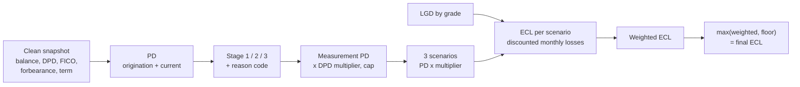

# Methodology

How the engine turns one month's loan book into an IFRS 9 provision. Every
threshold, multiplier, weight and floor named here is a value in
`config/ecl_parameters.xml`, loaded into the `PARAM_*` tables by `PKG_PARAMS`;
nothing is hardcoded in the PL/SQL. Run-specific results are in
[model_report.md](model_report.md), [data_profile.md](data_profile.md) and
[performance.md](performance.md); this note explains the method.

Each month, every open loan gets a **stage**, a **PD**, an **LGD** and an
**exposure**. ECL is the probability-weighted, discounted expected loss over
12 months for Stage 1 and over the remaining life for Stages 2 and 3, and it
never goes below the RBI floor.



## 1. Probability of default (Python)

- **Model:** logistic regression (scikit-learn `Pipeline`) on closed loans from
  matured vintages, target `default_flag` (charged off = 1). Application-time
  features only; every post-origination column is excluded and the scripts
  assert it (the leakage rule). Numbers: median imputation, then capped at the
  training 1st and 99th percentiles (all except FICO), then standard scaling.
  Categories: one-hot encoding. No class weighting and no resampling, because
  re-weighting would inflate the PDs. Validated out of time: trained on loans
  issued up to 2014, tested on 2015 issues.
- **Term to 12 months.** The model predicts default over the loan's full term
  T (36 or 60 months). With a constant monthly hazard:

  ```math
  PD_{12m} = 1 - (1 - PD_{term})^{12/T}
  ```

  e.g. 20% over 36 months is 7.17% over 12.
- **Two PDs per loan:** `pd_12m_orig` uses the application data as at
  origination. `pd_12m_current` uses the same model and features with today's
  FICO in place of the origination FICO, so a falling score raises the PD. If
  data quality flagged today's FICO (DQ008), the origination FICO is used.
  FICO is the one feature not capped, because current FICO can fall far below
  anything seen at origination (Lending Club lent at 660+). Both PDs are
  floored at `PD_FLOOR` (0.05%).

## 2. Staging (PL/SQL, `PKG_STAGING.fn_assign_stage`)

Checked in this order; the first rule that applies decides the stage and the
reason code:

| Order | Rule | Stage | Reason code |
|---|---|---|---|
| 1 | DPD above `STAGE3_DPD` (90): the 90-day NPA rule | 3 | `DPD_90` |
| 2 | Lending Club status `Default` | 3 | `DEFAULT_STATUS` |
| 3 | DPD above `STAGE2_DPD` (30): the rebuttable 30-day backstop | 2 | `DPD_30` |
| 4 | Forbearance (hardship) flag `Y` | 2 | `FORBEARANCE` |
| 5 | PD deterioration: `pd_12m_current >= SICR_RELATIVE x pd_12m_orig` **and** the increase is at least `SICR_ABSOLUTE` (2x and +0.5 points) | 2 | `PD_DETERIORATION` |
| 6 | Cure probation: Stage 2 or 3 at the previous assessment and fewer than `CURE_MONTHS` (3) straight months meeting every Stage 1 condition | 2 | `CURE_PROBATION` |
| 7 | Otherwise | 1 | `PERFORMING` |

- PD deterioration needs both tests: doubling a tiny PD (0.1% to 0.2%) is not a
  significant increase, and neither is a small relative move on a high PD.
- The cure counter counts consecutive good months. A Stage 2 loan back at DPD
  0 stays in Stage 2 (`CURE_PROBATION`) in its first and second good months
  and returns to Stage 1 in the third. A relapse resets the counter. The RBI's
  final directions dropped a mandatory cooling period, so `CURE_MONTHS` is a
  bank policy setting.
- Each month starts from the loan's previous assessment in
  `LOAN_STAGE_HISTORY`, so re-running a month gives the same answer.
  `LOAN_STAGE_CURRENT` holds the latest stage. Updating it fires
  `TRG_STAGE_CHANGE_AUDIT`, which writes every real stage change to
  `STAGE_CHANGE_AUDIT`.
- `stage3_since` is the day the loan crossed 90 DPD (the reporting date minus
  the days beyond 90), so the time-in-Stage-3 floor counts from the real date.
- A loan missing from a month's clean snapshot is marked exited, not deleted.

## 3. PD used for measurement

| Stage | Measurement PD |
|---|---|
| 1 and 2 | `pd_12m_current` x DPD multiplier, capped at `PD_CAP` (0.99) |
| 3 | 1 (the loan has defaulted) |

DPD multipliers: 0 DPD 1.0; 1-30 DPD 2.0; 31-60 DPD 3.5; 61-90 DPD 6.0. They
affect measurement only, not staging: delinquency already drives staging
through the 30-day backstop.

## 4. Loss given default (SQL, `PKG_LGD.calibrate`)

From charged-off loans in the development set:

```math
LGD = 1 - \frac{recoveries - collection\_recovery\_fee}{funded\_amnt - total\_rec\_prncp}
```

- The denominator is the exposure at default (principal still owed when the
  loan was charged off). Each loan's LGD is bounded to 0..1.
- Average by grade A to G, weighted by exposure at default, so a $30,000 loss
  counts more than a $1,000 one. Stored in `PARAM_LGD` with the number of
  defaults behind it; row `ALL` is the portfolio average.
- A grade with fewer than `LGD_MIN_DEFAULTS` (500) defaults uses the portfolio
  average instead and is flagged as a fallback.
- Recoveries are not discounted. A real workout LGD would discount them at the
  loan's effective interest rate.

## 5. Exposure at default

With current balance B, monthly rate r = `int_rate` / 12 and n remaining
months, rebuild the level payment and roll the balance forward:

```math
P = \frac{B \, r}{1 - (1 + r)^{-n}}, \qquad B_t = B_{t-1}(1 + r) - P, \qquad EAD_t = B_{t-1}
```

The set-based engine uses the closed form, so no month depends on the month
before it:

```math
B_k = B (1 + r)^k - P \, \frac{(1 + r)^k - 1}{r}
```

EAD is never below 0. When r = 0 the schedule is a straight line, B_k = B (1 -
k/n). Stage 3 uses today's balance with no schedule. There is no accrued
interest and no undrawn limit, because these are term loans.

## 6. Expected credit loss

The 12-month PD becomes a monthly hazard, and the discounted marginal losses
are summed over the horizon H: min(12, n) for Stage 1, n for Stage 2. The
contract rate stands in for the effective interest rate.

```math
h = 1 - (1 - PD_{12m})^{1/12}
```

```math
ECL = \sum_{t=1}^{H} (1 - h)^{t-1} \, h \cdot LGD \cdot EAD_t \cdot (1 + r)^{-t}
```

(1 - h)^(t-1) is the chance the loan survives to month t, h the chance it
defaults in that month, and (1 + r)^-t discounts the loss to the reporting
date. Stage 3: ECL = LGD x current balance.

**Scenarios.** The ECL is computed once per scenario with PD x the scenario's
multiplier (capped at `PD_CAP`), then weighted by the scenario probabilities:

| Scenario | Weight | PD multiplier |
|---|---|---|
| `BASE` | 0.60 | 1.00 |
| `DOWNSIDE` | 0.30 | 1.30 |
| `SEVERE` | 0.10 | 1.80 |

The weights must sum to 1. `PKG_PARAMS` refuses a file where they don't. The
ECL rises with the PD, so the weighted ECL always sits between the base and
the severe ECL, and the engine checks this on every loan.

## 7. RBI floors

Final ECL = the larger of the weighted model ECL and the floor rate x current
balance. `ECL_RESULT` stores the model ECL, the floor amount, the final ECL
and a `floor_applied` flag, and two check constraints guarantee the rule on
every row.

| Case | Floor (% of balance) |
|---|---|
| Stage 1 | 1.00% |
| Stage 2 | 5.00% |
| Forbearance loan in Stage 1 (restructured) | 5.00% |
| Forbearance loan in Stage 2 (restructured) | 10.00% |
| Stage 3, months 0-11 in Stage 3 | 40% |
| Stage 3, month 12 onwards | 100% |

These are the values in `config/ecl_parameters.xml` for unsecured retail under
the RBI final ECL directions, per ICRA and Uniqus (see [SPEC.md](SPEC.md)). The
Stage 3 rows are the general schedule for unsecured exposures; check Annex N
of the directions before quoting them as the unsecured retail schedule. The
Stage 3 bands are half-open: from-month inclusive, to-month exclusive.

## 8. Worked example: the golden loan

<!-- golden:start -->

Inputs: balance $10,000, rate 12% a year (r = 1% a month), 24 months left, 12-month PD 5%, LGD 80%, DPD 0, base scenario only.

- Level payment P = B r / (1 - (1 + r)^-n) = **$470.73**
- Monthly hazard h = 1 - (1 - PD_12m)^(1/12) = **0.42653%**

Stage 1, month by month (horizon min(12, n) = 12):

| t | EAD_t = B_(t-1) | Survival (1-h)^(t-1) | Default in month t | Discount (1+r)^-t | Discounted loss |
| ---: | ---: | ---: | ---: | ---: | ---: |
| 1 | 10,000.00 | 1.000000 | 0.004265 | 0.990099 | 33.7847 |
| 2 | 9,629.27 | 0.995735 | 0.004247 | 0.980296 | 32.0727 |
| 3 | 9,254.82 | 0.991488 | 0.004229 | 0.970590 | 30.3901 |
| 4 | 8,876.64 | 0.987259 | 0.004211 | 0.960980 | 28.7366 |
| 5 | 8,494.67 | 0.983048 | 0.004193 | 0.951466 | 27.1116 |
| 6 | 8,108.88 | 0.978855 | 0.004175 | 0.942045 | 25.5148 |
| 7 | 7,719.23 | 0.974679 | 0.004157 | 0.932718 | 23.9457 |
| 8 | 7,325.69 | 0.970522 | 0.004140 | 0.923483 | 22.4039 |
| 9 | 6,928.21 | 0.966383 | 0.004122 | 0.914340 | 20.8891 |
| 10 | 6,526.76 | 0.962261 | 0.004104 | 0.905287 | 19.4007 |
| 11 | 6,121.29 | 0.958156 | 0.004087 | 0.896324 | 17.9385 |
| 12 | 5,711.77 | 0.954069 | 0.004069 | 0.887449 | 16.5020 |
| **Total** |  |  | 0.050000 |  | **298.6905** |

Discounted loss = default in month t x LGD x EAD_t x discount. The 12 months sum to $298.69; over the full 24 months (Stage 2) the same sum is $393.52.

| Case | Model ECL | Floor | Final ECL |
| --- | ---: | --- | --- |
| Stage 1 | $298.69 | 1% = $100.00 | $298.69 |
| Stage 2 | $393.52 | 5% = $500.00 | $500.00 (floor applied) |
| Stage 3 | $8,000.00 | 40% = $4,000.00 | $8,000.00 |

Generated by `python/golden_example.py` from `python/ecl/ecl_math.py`; `tests/test_ecl_golden.py` checks that the PL/SQL engine (`run_v2` and `run_v1`) reproduces the last table to the cent.

<!-- golden:end -->

## 9. How the engine computes it

- `PKG_ECL.run_v2` (production) is one `INSERT /*+ APPEND */ ... SELECT` over
  `V_ECL_INPUT`. It joins every loan to every scenario and to `MONTH_IDX`
  (months 1-60), one row per month of the horizon, then sums, pivots the
  scenarios, weights them and applies the floor. The per-month probability and
  discount maths is `BINARY_DOUBLE`. Stage 3 losses, floors and every stored
  amount are exact `NUMBER`, rounded to cents only when stored.
- `PKG_ECL.run_v1` is the deliberately row-by-row version: a cursor loop that
  calls `fn_ecl_loan` per loan per scenario, in exact `NUMBER`.
  `PKG_ECL.compare_versions` returns the largest difference between the two
  over every money column and every loan. It has been $0.00 on every month
  tested.
- Rounding: scenario ECLs are kept unrounded for the weighting, and each stored
  amount is rounded to cents once.

## 10. Simplifications

- A constant hazard over the loan's life, and the contract rate used as the
  effective interest rate.
- Scenarios are PD multipliers, not a macroeconomic model.
- Staging is tested on the base scenario only.
- Stage 3 is assessed per loan. The RBI applies it per borrower, but the
  public data has no usable borrower id.
- Current FICO is plugged into a model trained on origination FICO.
- LGD is a historical average by grade, with no collateral, no cure modelling
  and undiscounted recoveries.
- The monthly history after the first month is simulated (see
  [SPEC.md](SPEC.md) and the README), and the RBI rules are applied to US
  Lending Club data as an exercise.
