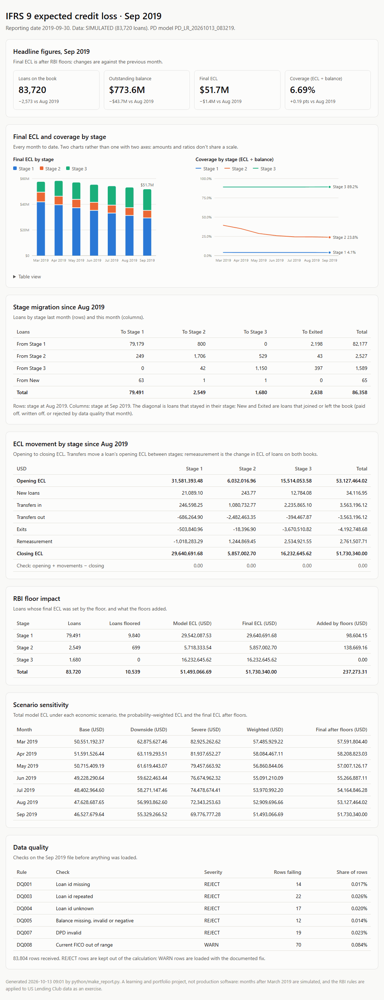

# Sample report: September 2019

One month of batch output, copied from `reports/20190930/`. To read the report,
download `ecl_report.html` and open it in a browser (GitHub shows HTML files as
source). `ecl_report.png` is a screenshot of it.

| File | Contents |
|---|---|
| `ecl_report.html` | The management report: headline figures, final ECL and coverage by stage over every month, stage migration, ECL movement, RBI floor impact, scenario sensitivity and data quality. One self-contained file with inline SVG charts, built by `python/make_report.py`. |
| `ecl_by_stage.csv` | `V_ECL_BY_STAGE`: loans, balance, final ECL, coverage and share of balance by stage |
| `ecl_by_grade.csv` | `V_ECL_BY_GRADE`: the same by Lending Club grade and stage |
| `ecl_by_state.csv` | `V_ECL_BY_STATE`: the same by borrower state and stage |
| `stage_migration.csv` | `V_STAGE_MIGRATION`: loans and balance from August's stage to September's |
| `ecl_movement.csv` | `V_ECL_MOVEMENT`: opening to closing ECL by stage |
| `floor_impact.csv` | `V_FLOOR_IMPACT`: loans floored and the ECL the floors added |
| `scenario_sensitivity.csv` | `V_SCENARIO_SENSITIVITY`: total ECL under each scenario |
| `dq_summary.csv` | `V_DQ_SUMMARY`: data quality errors by rule |

The batch also writes `ecl_detail.csv`, one row per loan (about 14 MB a month).
It isn't committed: generated data stays out of git. See
[powerbi_guide.md](../powerbi_guide.md) for building a dashboard from these files.
